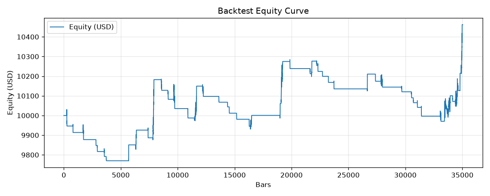
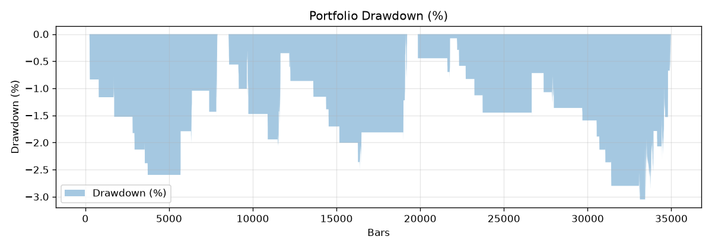

# binance-futures-bot-backtester
Python trading bot &amp; event-driven backtester for Binance Futures (USDT-M)
# Binance Futures Trading Bot & Event-Driven Backtester (Python)

Production-ready Python algorithmic trading framework and event-driven backtester for **Binance Futures (USDT-M)**. Covered by automated tests (`18/18 pytest passed`), Docker-ready, and delivered as a standalone ZIP source code archive.

> **[Download Full Source Code (ZIP) on Boosty — 5 000 ₽](https://boosty.to/productioncrupto1/posts/c75a22ce-1e86-4578-9fbf-da7199939734?share=post_link)**  
> *(Instant file access after payment • Russian & international cards accepted)*

---

## Key Features
- **Event-Driven Architecture:** Clean Python trading engine and backtester designed to prevent lookahead bias and ensure deterministic reproducibility.
- **Automated Testing:** Full `pytest` suite (**18/18 tests passing**).
- **Ready-to-Use Configs:** YAML strategy configs for `BTCUSDT 15m` and `ETHUSDT 15m` + `.env.example` template.
- **Docker Support:** Includes `docker-compose.yml` and step-by-step `README.md` documentation.

## Backtest Results (365 Days, Real Binance USDT-M Data, 0.5% Risk/Trade)

| Pair | Test Type | Profit Factor | Max Drawdown | Sharpe / Calmar | Trades |
| :--- | :--- | :---: | :---: | :---: | :---: |
| **BTCUSDT (15m)** | Historical (365d) | **1.39** | **3.05%** | 1.13 / 1.52 | 53 |
| **ETHUSDT (15m)** | Blind Out-of-Sample (no overfitting) | **1.04** | **4.65%** | Monte Carlo p95 DD: 9.48% (500 sims) | 64 |

### Equity & Drawdown Curves

---

## Описание на русском

Готовый исходный код торгового бота и event-driven бэктестера для **Binance Futures (USDT-M)** на Python.

**Что внутри ZIP-архива:**
- Полный исходный код торгового движка и событийного бэктестера на Python
- Автотесты `pytest` (18/18 passed)
- Готовые YAML-конфиги (`BTCUSDT 15m`, `ETHUSDT 15m`) и шаблон `.env.example`
- `docker-compose.yml` и подробная инструкция по запуску `README.md`

👉 **[Получить полный ZIP-архив на Boosty (5 000 ₽)](https://boosty.to/productioncrupto1/posts/c75a22ce-1e86-4578-9fbf-da7199939734?share=post_link)** — доступ к скачиванию открывается сразу после оплаты.

---

*Disclaimer: This repository showcases software source code for algorithmic trading and strategy testing. It is not financial or investment advice and does not guarantee future profitability. Non-exclusive license for personal use and modification.*
